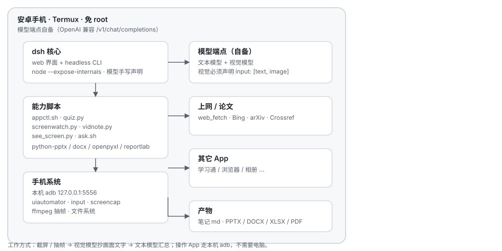

# dsh-termux-oneclick


**一句话**：把一台安卓手机变成能自己干活的 AI —— 不用 root、不用电脑常开、电脑关机照样用。

把 dsh（DeepSeek Harness）原封不动装进 Termux，再让它通过**本机 adb 自己控制自己**：
读屏幕、按文字点按钮、截图复核、抽帧看视频。

本仓库是一套**在一台真实手机上跑通**的配置 + 脚本 + 踩坑记录：50 个文件、3700+ 行、12 篇中文文档。

> ⚠️ 本仓库**不含任何模型代理/逆向实现**。你需要自备一个 OpenAI 兼容的 `/v1/chat/completions` 端点
> （本机 `127.0.0.1:8787`、局域网、或任何云端兼容服务都行），填进配置即可。



---

## 目录

- [真实运行输出](#真实运行输出实测节选) · [能力一览](#能力一览) · [硬性前提](#硬性前提) · [目录结构](#目录结构)
- [快速开始（5 步）](#快速开始5-步) · [模型接入](#模型接入自备端点) · [手机自我接管](#手机自我接管不需要电脑)
- [动作编排与自愈](docs/11-动作编排与自愈.md) · [回退链与反思](docs/12-回退链与反思循环.md) · [常用命令速查](#常用命令速查)
- [实测状态](#实测状态诚实清单) · [相关项目](#相关项目本项目不是首创) · [安全与免责](#安全与免责)

> 想发动态/分享？[`docs/images/share-card.png`](docs/images/share-card.png) 是配好版式的宣传图，
> [`docs/images/architecture.png`](docs/images/architecture.png) 是架构图的位图版本。

---

## 真实运行输出（实测节选）

### 1. 读屏幕：`bash ~/dsh-phone/appctl.sh text`

```
mCurrentFocus=Window{b80c70 u0 tv.danmaku.bili/...StoryTransparentActivity type=1 }
[可点] 关注 <View> @804,2571
[可点] 点赞 <Button> @1327,1571
[-] 64 <TextView> @1327,1655
[可点] 发弹幕 <TextView> @402,3011
[可点] 全屏 <ImageView> @1343,3007
[可点] 返回 <ImageView> @93,231
```

每条都带**坐标**和**是否可点**，所以后续能直接 `tap-text "全屏"`，不用猜位置。

### 2. 看视频出笔记：`python ~/dsh-phone/screenwatch.py --minutes 15 --interval 20`

```
开始抓屏：每 20s 一张，共 15.0 分钟 → ~/tmp/vid/live-1112-2256
[0:01] 1) 画面文字：… 2) 这一屏在讲：一位厨师正在餐厅里进行尝汤（试味）环节。
[0:28] 1) 画面文字：… 2) 这一屏在讲：…
笔记已写入: ~/tmp/vid/live-1112-2256/笔记.md
帧数: 2
```

（这次只跑了 45 秒做验证，所以帧少；画面 md5 相同会自动跳过。）

### 3. 生成的笔记长这样

```markdown
### 一、本节内容主线
1. …
### 二、关键概念与定义
- **菜品卡**：用于标准化菜品制作流程与标准的卡片，需在实际操作中落实执行。
### 三、可能被考到的点
1. 视频中复盘的是哪种类型的客诉事件？ A… B… **答案：B**
### 四、看不懂/信息缺失的地方
- 该时段画面无文字，建议回看 03:20 附近
```

---

## 能力一览

| 能力 | 靠什么实现 | 入口脚本 | 文档 |
|---|---|---|---|
| 识图 / 看图答题 | 视觉模型 + `read_image` | — | [docs/04](docs/04-识图.md) |
| 操作手机上的其它 App | 本机 adb + uiautomator | `appctl.sh` | [docs/03](docs/03-操作其它App.md) |
| 动作编排与自愈（点得稳） | 可点元素瘦身 + 界面对比重试 + 元素知识库 | `appctl.sh` / `act_batch.py` | [docs/11](docs/11-动作编排与自愈.md) |
| 多端点回退链（抗挂） | 端点×模型排队试，错一个换下一个 | `llm.py` | [docs/12](docs/12-回退链与反思循环.md) |
| 操作反思循环 | 点了没反应 → 截图问视觉模型为什么 | `smartstep.py` | [docs/12](docs/12-回退链与反思循环.md) |
| 看视频/出笔记也抗挂 | 逐帧识图 + 汇总全走回退链 | `vidnote.py` / `screenwatch.py` | [docs/12](docs/12-回退链与反思循环.md) |
| 章节测验/在线答题（高正确率） | 多模型投票 + 检索兜底 | `quiz.py` | [docs/05](docs/05-满分答题流水线.md) |
| 看视频出笔记 | 截屏抽帧 + 视觉模型读画面 | `screenwatch.py` / `vidnote.py` | [docs/06](docs/06-看视频出笔记.md) |
| 上网查资料 / 写论文 | `web_fetch` 抓 Bing / arXiv / Crossref / PubMed | — | README「联网」 |
| 生成文档 | python-pptx / python-docx / openpyxl / reportlab | — | README「文档」 |
| 手机自我接管（ADB/SSH） | adb tcpip + sshd | `fix-adb.sh` | [docs/02](docs/02-接管手机-ADB与SSH.md) |
| 一句话交给 Agent | headless CLI | `ask.sh` | [docs/01](docs/01-快速开始.md) |

---

## 硬性前提

- Android **arm64**（`aarch64`），Termux（F-Droid 或 GitHub 版，**不要用 Google Play 版**）
- Node ≥ 20（实测 v24）、Python ≥ 3.10（实测 3.14）
- `dsh-termux` 预编译包（上游发布，见 [docs/01](docs/01-快速开始.md)）
- 一个 OpenAI 兼容端点 + API Key（**不提供**，自备）

---

## 目录结构

```
.
├── README.md
├── docs/                       # 全部使用说明
│   ├── 01-快速开始.md
│   ├── 02-接管手机-ADB与SSH.md
│   ├── 03-操作其它App.md
│   ├── 04-识图.md
│   ├── 05-满分答题流水线.md
│   ├── 06-看视频出笔记.md
│   ├── 07-提示词大全.md
│   ├── 08-能力清单与实测.md
│   ├── 09-常见问题.md
│   ├── 10-AGENTS配置.md
│   ├── 11-动作编排与自愈.md
│   ├── 12-回退链与反思循环.md
│   └── images/                  # architecture.svg / .png、share-card.png
├── config/
│   ├── cordis.patch.yml        # dsh 在安卓上必须的配置补丁
│   ├── dshx.sh                 # dsh 启动包装器（必须带 --expose-internals）
│   ├── up.sh                   # 一键启动 + 打印网页 token 地址
│   ├── AGENTS.md               # 给 Agent 的行为规矩（可直接放进工作区）
│   └── vision-overlay.yml      # headless 时补上视觉模型
├── scripts/
│   ├── phone/                  # 装到手机 ~/dsh-phone/
│   ├── phone/patches/          # dsh 在 Termux 上的补丁与探测脚本
│   ├── pc/                     # 电脑侧推送/修复脚本（PowerShell）
│   └── extras/                 # 附加示例：从 docx 截图批量提答案
├── LICENSE
└── .gitignore
```

---

## 快速开始（5 步）

```bash
# 1) Termux 基础环境
pkg update -y && pkg install -y nodejs python git openssh tmux termux-api

# 2) 装 dsh-termux（用你自己的 tarball / 上游包）
npm i -g ./dsh-termux.tgz        # 或 npm i -g dsh-termux

# 3) 放配置
mkdir -p ~/.dsh/profiles/web ~/dsh-phone
cp config/cordis.patch.yml ~/.dsh/profiles/web/cordis.patch.yml
cp config/dshx.sh config/up.sh ~/dsh-phone/ && chmod +x ~/dsh-phone/*.sh

# 4) 起服务（会打印 http://127.0.0.1:3080/?token=...）
bash ~/dsh-phone/up.sh

# 5) 装能力脚本
cp scripts/phone/*.sh scripts/phone/*.py ~/dsh-phone/ && chmod +x ~/dsh-phone/*.sh
```

浏览器打开上一步打印的 `?token=` 地址 → 就能对话了。

详细步骤与逐条验证：[docs/01-快速开始.md](docs/01-快速开始.md)

---

## 模型接入（自备端点）

编辑 `config/cordis.patch.yml` 里这一段：

```yaml
- id: llm-pi-ai
  config:
    providers:
      openai:
        displayName: 本地网关
        api: openai-completions
        baseURL: http://127.0.0.1:8787/v1     # ← 换成你的端点
        apiKeyEnv: OPENAI_API_KEY
        models:
          - id: <文本模型 id>
            name: <显示名>
          - id: <视觉模型 id>
            name: <显示名>
            input: [text, image]               # ← 视觉模型必须声明
```

```bash
export OPENAI_API_KEY=你的key        # dshx.sh 里默认写的是 local-noop
```

**四条血泪结论**（不改就起不来，详见 [docs/01](docs/01-快速开始.md#为什么这些配置非改不可)）：

1. `--expose-internals` 必须加，否则安卓缺 `node-addon-require-builtin` 原生绑定直接崩。
2. `sandbox-policy.mode: danger-full-access` + `approval.policy: never`，安卓没有沙箱后端。
3. **模型 ID 必须手写**：很多兼容端点的 `/v1/models` 返回格式与 dsh 期望的不一致，自动拉取会是空的。
4. 视觉模型不声明 `input: [text, image]`，图片会被**静默丢弃**，模型只看到占位符——这是"为什么它说看不见图"的根因。

### 多端点回退（可选，但强烈建议）

dsh 本体只吃一个端点；脚本层走的是 `llm.py`，可以配一整条链，挂一个自动换下一个：

```bash
cat > ~/dsh-phone/endpoints.json <<'JSON'
{"timeout": 90, "retries_per_endpoint": 2,
 "endpoints": [
  {"name":"local","base":"http://127.0.0.1:8787/v1/chat/completions","key":"local-noop",
   "models":["deepseek-v4-pro"],"vision_models":["glm-5v-turbo"]},
  {"name":"cloud","base":"https://api.example.com/v1/chat/completions","key":"sk-xxx",
   "models":["gpt-4o-mini"],"vision_models":["gpt-4o"]}
 ]}
JSON
python ~/dsh-phone/llm.py --ping        # 逐个探活，看谁通
```

细节与实测：[docs/12-回退链与反思循环.md](docs/12-回退链与反思循环.md)

---

## 手机自我接管（不需要电脑）

```bash
pkg install -y android-tools          # 提供 adb
adb connect 127.0.0.1:5556            # 连自己（需先在同一 Wi-Fi 下开一次无线调试）
bash ~/dsh-phone/appctl.sh text       # 读当前屏幕的所有文字 + 坐标
bash ~/dsh-phone/appctl.sh tap-text "发送"
```

> 每次从别的进程调 adb，记得加 `</dev/null`，否则 adb 会挂着等 stdin。

详见 [docs/02](docs/02-接管手机-ADB与SSH.md)、[docs/03](docs/03-操作其它App.md)。

---

## 常用命令速查

```bash
bash ~/dsh-phone/up.sh                          # 起 dsh，打印 token 网页地址
bash ~/dsh-phone/ask.sh "把桌面截图，读一下上面写了什么"
bash ~/dsh-phone/appctl.sh cur|text|shot|apps    # 当前 App / 屏幕文字 / 截图 / 装了什么
bash ~/dsh-phone/appctl.sh open com.chaoxing.mobile
bash ~/dsh-phone/appctl.sh tap-text "登录" | tap X Y | type abc | key KEYCODE_BACK

# 让点击变稳的那几个（见 docs/11）
bash ~/dsh-phone/appctl.sh text --click          # 只给可点元素，省 token
bash ~/dsh-phone/appctl.sh tap-text "登录" --verify     # 点完自检，没变化自动重试
bash ~/dsh-phone/appctl.sh wait-text "首页" 15   # 等元素出现，别用 sleep 赌
bash ~/dsh-phone/appctl.sh kb save 微信首页      # 控件知识库：摸过的界面存下来
python ~/dsh-phone/llm.py --ping                 # 探活：所有模型端点谁通谁挂
python ~/dsh-phone/smartstep.py --goal "打开设置" --dry-run    # 带反思的自动操作（先干跑）
python ~/dsh-phone/act_batch.py steps.json --dry-run     # 多步动作，先干跑再真跑

python ~/dsh-phone/quiz.py solve ~/tmp/q.json    # 多模型投票答题
python ~/dsh-phone/screenwatch.py --minutes 15 --interval 20   # 看视频出笔记
bash ~/dsh-phone/fix-adb.sh                      # 手机重启后修 adb
```

---

## 联网与文档能力

- **搜索**：`web_fetch` 抓 `https://cn.bing.com/search?q=...`（手机端 `web_search` 通常没有 provider）。
- **论文**：arXiv / Crossref / PubMed 的公开 API 直接可用；Semantic Scholar 会 429 限流。
- **文档**：`python-pptx` / `python-docx` / `openpyxl` / `reportlab` 直接生成；
  **没有 LibreOffice**，docx/pptx 转 PDF 只能重排或用 WPS 导出。

---

## 实测状态（诚实清单）

| 项 | 状态 |
|---|---|
| dsh web 界面 | ✅ 可用 |
| 视觉识图 | ✅ 可用（需声明 image 的视觉模型） |
| 手机 App 自动化 | ✅ 可用（读屏依赖 a11y，**微信读不到**） |
| 点击自愈（`--verify`） | ✅ 实测：界面无变化会重试并最终 `GIVE_UP` |
| 控件知识库（`kb`） | ✅ 实测：save/list/get 往返正常 |
| 多步批量（`act_batch.py`） | ✅ 实测：6 步干跑全解析 |
| 多端点回退链 | ✅ 实测：前两个端点写坏，自动跳到第三个 1591ms |
| 敏感词拦截（支付/验证码等） | ✅ 实测：`确认支付` 被拦、`设置` 放行 |
| 操作反思循环 | ✅ 实测：干跑能读屏并给出 done/动作计划 |
| vidnote/screenwatch 接回退链 | ⚠️ 代码已改，真机全流程复测待补（见 docs/12） |
| 视觉模型缺失时的反思 | ❌ 无视觉模型则反思不可用（会报错跳过） |
| 音视频理解 | ❌ 无音视频模型，只能抽帧读画面 |
| docx/pptx → pdf | ❌ 手机无 LibreOffice |
| `/tmp` 写入 | ❌ Termux 下不可写，用 `~/tmp` |
| 微信自动化 | ❌ uiautomator 拿到的是空树 |

---

## 相关项目（本项目**不是首创**）

单点技术全是别人的东西，这里只是把它们在「Termux + 本机 adb + 免 root」的环境里拼起来：

**安卓上原生跑 CLI Agent**
- [naiyQAQ/claude-code-termux](https://github.com/naiyQAQ/claude-code-termux) —— 原生 Termux，Bun 运行时，不用 proot
- [Rathodpd99/claude-code-android](https://github.com/Rathodpd99/claude-code-android) —— 走 proot-Ubuntu
- [ferrumclaudepilgrim/claude-code-android](https://github.com/ferrumclaudepilgrim/claude-code-android/blob/v2.9.3/docs/adb-wireless.md) —— 里的 `adb-wireless` 文档：**"手机用 adb 控制自己"这件事别人早就写过**

**手机 GUI Agent / 自动操作手机**
- [droidrun / mobilerun](https://github.com/droidrun/mobilerun) —— LLM 无关的手机 Agent，工程最完整；本项目「结构化动作序列」借鉴自它
- [X-PLUG/MobileAgent](https://github.com/x-plug/mobileagent) —— 阿里 Mobile-Agent 系列，已到 v3；「操作失败重试/校验」思路借鉴自它
- [AppAgent](https://appagent-official.github.io/) —— 多模态手机 Agent 的经典论文；「探索建元素知识库」思路借鉴自它
- AutoGLM 系列 —— 主打替用户点屏幕的商业化方向

**更底层的老工具**
- `uiautomator2`、Appium、AutoJS、Tasker + AutoInput、Termux:API —— 无障碍树当输入、坐标当输出这套玩法，十年前就有

**那这个仓库的增量是什么？** 老实说不是概念，是这四样：

1. 别人给**框架**，这里给"在一台真机上跑通"的**补丁与结论**（`--expose-internals`、`input:[text,image]`、Termux 没有 `/tmp`、微信空树……这些框架文档里没有）
2. 不 proot、不连电脑，电脑关机照样跑
3. 落到**具体活**：多模型投票答题流水线、网课抽帧出笔记、一键出 PPT/Word/Excel/PDF
4. 把**做不到的红灯**也写出来（[实测状态](#实测状态诚实清单)）

要通用能力，去用上面那些框架；要"安卓手机上照着做就能起来"，看这里。

---

## 安全与免责

- 服务**只监听 127.0.0.1**，不要改 `--host 0.0.0.0`；不要把 token 网页地址发给别人。
- 不要用本仓库做：代付、输入支付密码、绕过验证码、登录他人账号、批量刷课等违规用途。
- 自动化操作第三方 App 可能违反其用户协议，**后果自负**。
- Agent 会读写你手机上的文件（`danger-full-access`），请只在自己的设备上使用。
- 模型输出可能出错，考试、财务、医疗类内容请自己复核。

## License

MIT，见 [LICENSE](LICENSE)。
